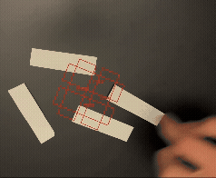

# Algorithm Demonstrations

This repository contains three algorithm implementations developed to demonstrate different aspects of the Pick-and-Place method used for the xArm6 assignment.

## Repository Structure

```text
main/
├── main-alignment-grid.py          # Align paper rectangles to the grid
├── main-orientation-detection.py  # Detect the orientation of the profiles
|── main-p-controller              # Showcase of the Proportional (P) controller
└── videos                          # Gifs
```

## Algorithms

### 1. Profile's Projection Alignment to Grid

**File:** `main-alignment-grid.py`

This algorithm demonstrates the alignment of paper rectangles to a predefined grid. The objective is to determine the position and orientation of the paper rectangles and align them with the corresponding grid positions.

**Demonstration:**



**Full Video:**
https://youtu.be/DKSGdH1qu2o

### 2. Profile Orientation Detection

**File:** `main-orientation-detection.py`

This algorithm focuses on detecting the orientation of the profiles. It analyses the profile cross-section to determine its orientation, providing the information required for subsequent positioning or alignment operations.

**Demonstration:**


**Full Video:**
https://youtu.be/jUOoJr-z_Yw

### 3. Proportional (P) Controller

**File:** `main-p-controller`

This implementation showcases the behaviour of a Proportional (P) controller. The controller calculates the control action based on the difference between the desired reference value and the measured system output. Its purpose is to demonstrate how proportional control can be used to reduce the error and drive a system towards a desired setpoint.

**Demonstration:**


**Full Video:**
https://youtu.be/iQUSBZXovk4

